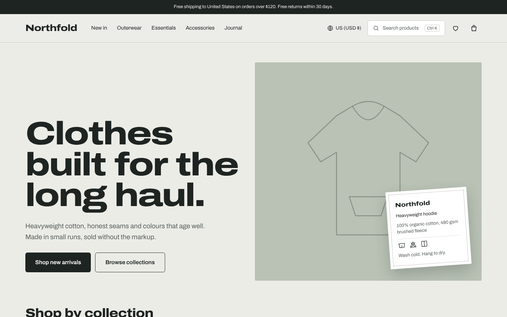
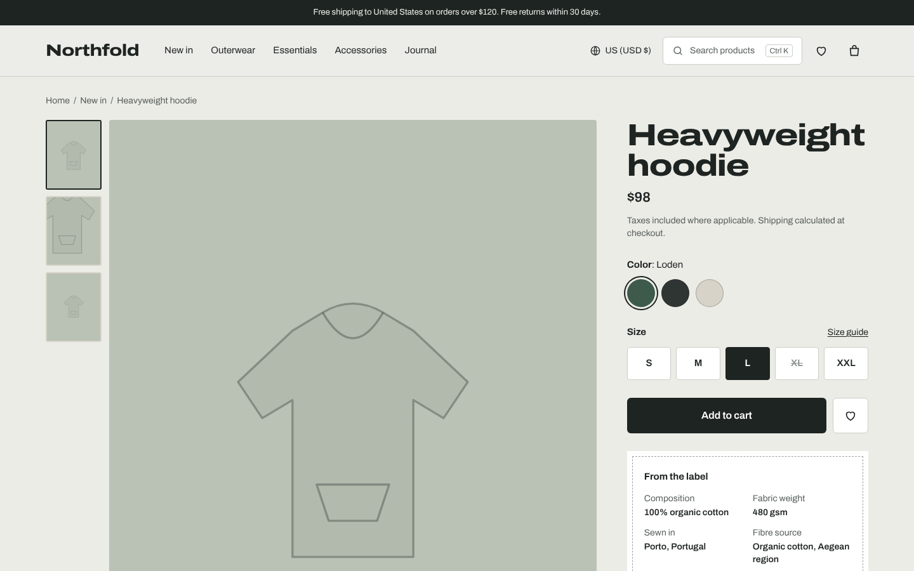
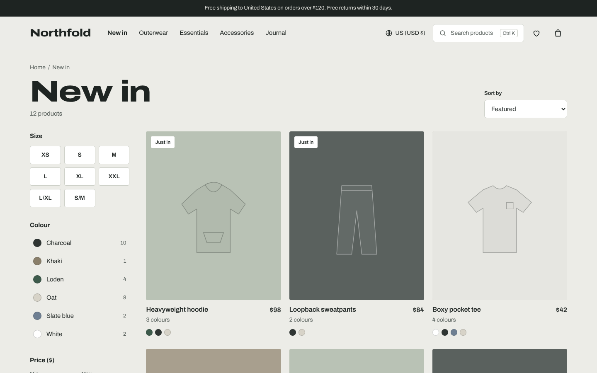
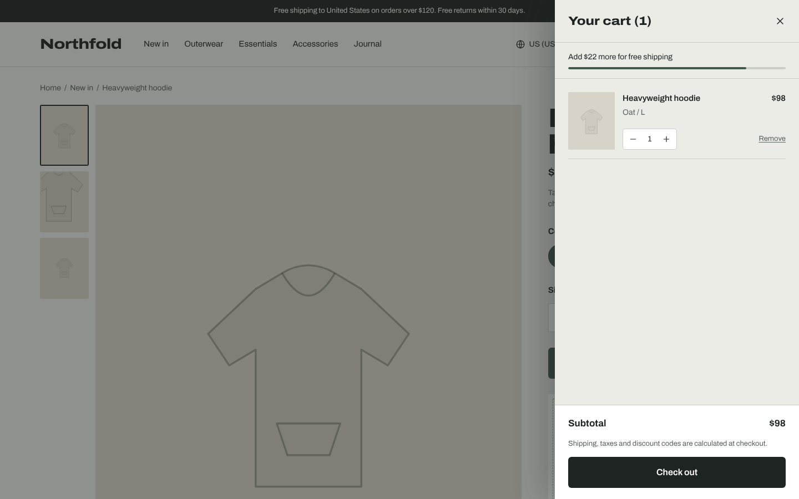
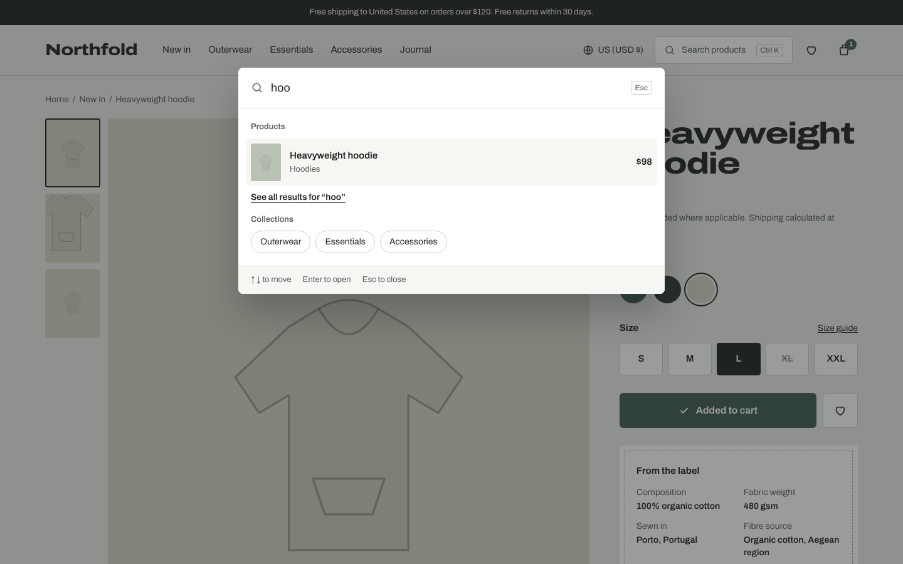
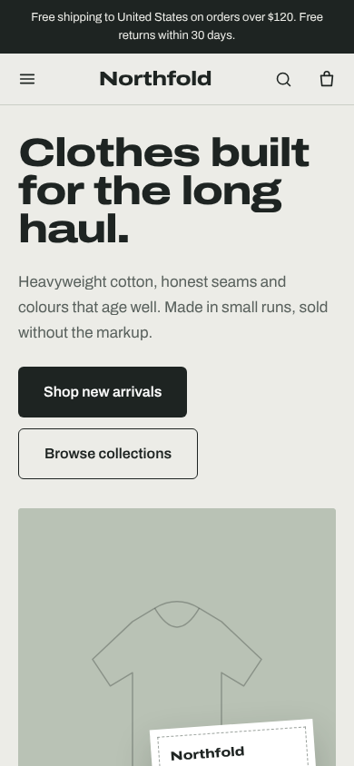
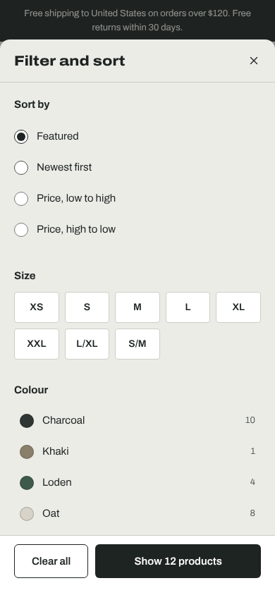

# Northfold — headless Shopify storefront

A storefront for a fictional apparel brand, built with **Next.js 15 (App Router)** on top of the
**Shopify Storefront API**. It runs against Shopify's public [mock.shop](https://mock.shop) sandbox
out of the box, or against any real Shopify store with two environment variables.

> Portfolio project. Northfold is not a real brand and the store does not sell anything.



<table>
  <tr>
    <td></td>
    <td></td>
  </tr>
  <tr>
    <td></td>
    <td></td>
  </tr>
</table>

<p>
  
  
</p>

## Features

**Shopping**

- Collection pages with size, colour and price filters, four sort orders and "load more". Filters live
  in the URL, so every result set can be shared and survives a reload.
- Product pages with a colour-aware gallery (thumbnails and hover zoom on desktop, swipe on mobile),
  variant selection synced to the URL, sold-out sizes shown and disabled, and a back-in-stock form.
- Cart drawer with optimistic updates (`useOptimistic`), quantity controls, a free-shipping progress bar
  and a hand-off to Shopify's hosted checkout.
- `⌘K` / `Ctrl K` search dialog with keyboard navigation (combobox pattern) plus a full results page.
- Wishlist saved on the device, with move-to-cart.
- Country and currency selector backed by Shopify Markets (`@inContext(country:)`). Switching market
  reprices the catalog and the existing cart.

**Content and trust**

- "From the label" block fed by product metafields (composition, fabric weight, origin, care).
- Reviews section with fit indicator. Reviews are clearly labelled sample data (see limitations).
- Journal with topic filters and shoppable "Products in this story".

**Quality**

- Loading skeletons, error boundaries with retry, empty states and a 404 page for every route.
- SEO: per-page metadata, canonical URLs, Open Graph, `sitemap.xml`, `robots.txt`, and JSON-LD for
  products (`ProductGroup` with per-variant offers), breadcrumbs and the organisation.
- Accessibility: WCAG 2.1 AA checked with axe in the end-to-end suite, native `<dialog>` for modals
  (focus trap and Escape for free), visible focus, 44 px targets, `prefers-reduced-motion` respected.
- Performance: Lighthouse on a production build with sample data scores 94–100 for Performance (mobile
  and desktop) and 100 for Accessibility, Best Practices and SEO on the home, collection, product and
  journal pages.
- Analytics: GA4 ecommerce events (`view_item_list`, `view_item`, `add_to_cart`, `remove_from_cart`,
  `add_to_wishlist`, `begin_checkout`, `search`) sent only after the visitor accepts the consent banner.

## Tech stack

| Area      | Choice                                                                                                |
| --------- | ----------------------------------------------------------------------------------------------------- |
| Framework | Next.js 15 App Router, React 19, TypeScript (strict, `noUncheckedIndexedAccess`)                      |
| Commerce  | Shopify Storefront API (GraphQL), mock.shop by default                                                |
| Styling   | Tailwind CSS 4 with design tokens in `globals.css`, Archivo variable font (width axis) via Fontsource |
| State     | Server Actions + `useOptimistic` for the cart, Zustand for UI state and the wishlist                  |
| Testing   | Vitest + Testing Library (45 tests), Playwright on desktop and mobile with axe (40 tests)             |
| Tooling   | ESLint, Prettier, GitHub Actions                                                                      |

## Architecture

```
src/
  app/                    Routes, server actions, route handlers, metadata routes
    actions/              cart.ts, market.ts (server actions)
    api/search            JSON search endpoint for the ⌘K dialog
    api/revalidate        Shopify webhook target for on-demand revalidation
  components/
    cart/ catalog/ product/ home/ journal/ search/ wishlist/ layout/ consent/ seo/ ui/
  lib/
    shopify/              Storefront API client, GraphQL documents, normalizers, fixtures
    catalog/              Pure filtering, sorting and variant-selection logic
    stores/               Zustand stores (UI, wishlist)
    analytics.ts          Consent-gated GA4 events
    markets.ts            Supported countries, currencies and free-shipping thresholds
  content/journal.ts      Journal articles as typed data
tests/
  unit/                   Vitest
  e2e/                    Playwright (desktop + Pixel 7)
```

**One data layer, two sources.** Every Storefront API call goes through `storefrontFetch` in
`lib/shopify/client.ts`. With `SHOPIFY_DATA_SOURCE=fixtures` the same named operations are answered by
a bundled sample catalog (`lib/shopify/fixtures`), including an in-memory cart. Tests and CI use it, so
they never depend on the network. UI code only sees normalized types from `lib/shopify/types.ts`.

**Caching.** Pages render per request because they read the cart and market cookies, but catalog
requests go through Next's Data Cache with `products` and `collections` tags (one-hour revalidation).
`POST /api/revalidate?secret=…` invalidates those tags when Shopify sends a product or collection
webhook. Cart requests are never cached.

**Cart state.** The cart ID lives in an `httpOnly` cookie. Mutations are server actions that call the
Storefront API and revalidate the layout. The client applies the change first with `useOptimistic`,
so the drawer updates instantly and rolls back if Shopify returns an error (shown as a toast with retry).

**Filtering.** Collection filters run as pure functions over normalized products
(`lib/catalog/filters.ts`) rather than through Storefront API `filters`, so they behave the same on
mock.shop, fixtures and stores without the Search & Discovery app. For catalogs beyond a few hundred
products, swap in Storefront API filters and cursor pagination.

## Getting started

Requires Node.js 20.9 or newer.

```bash
npm install
cp .env.example .env.local
npm run dev              # live data from mock.shop
npm run dev:fixtures     # bundled sample data, works offline
```

Open http://localhost:3000.

### Environment variables

| Variable                      | Purpose                                                  |
| ----------------------------- | -------------------------------------------------------- |
| `SHOPIFY_DATA_SOURCE`         | `live` (default) or `fixtures`                           |
| `SHOPIFY_STOREFRONT_ENDPOINT` | Storefront API URL. Empty means `https://mock.shop/api`  |
| `SHOPIFY_STOREFRONT_TOKEN`    | Public Storefront API token for a real store             |
| `SHOPIFY_REVALIDATION_SECRET` | Shared secret for `/api/revalidate`                      |
| `NEXT_PUBLIC_SITE_URL`        | Absolute URL for canonical links, sitemap and Open Graph |
| `NEXT_PUBLIC_GA_ID`           | Optional GA4 measurement ID, loaded only after consent   |

### Connecting a real Shopify store

1. In Shopify admin, create a custom app with Storefront API access and copy the public token.
2. Set `SHOPIFY_STOREFRONT_ENDPOINT=https://<store>.myshopify.com/api/2025-07/graphql.json` and
   `SHOPIFY_STOREFRONT_TOKEN`.
3. Optional: create product metafields in the `custom` namespace (`composition`, `fabric_weight`,
   `origin`, `fibre_source`, `care`, `fit`) and expose them to the Storefront API to fill the label.
4. Run `npm run verify:live` to send every query and mutation the app uses to the store and see which
   ones succeed.

## Scripts

| Command                                       | What it does                                                      |
| --------------------------------------------- | ----------------------------------------------------------------- |
| `npm run dev` / `dev:fixtures`                | Development server with live or sample data                       |
| `npm run build` / `start`                     | Production build and server                                       |
| `npm run lint` / `typecheck` / `format:check` | Static checks                                                     |
| `npm test`                                    | Unit and component tests                                          |
| `npm run test:e2e`                            | Builds with sample data and runs Playwright on desktop and mobile |
| `npm run verify:live`                         | Checks every GraphQL operation against the live endpoint          |
| `npm run check`                               | Lint, typecheck, unit tests and build                             |

## Deploying to Vercel

1. Push the repository to GitHub and import it in Vercel.
2. Add `NEXT_PUBLIC_SITE_URL` with your Vercel URL. Leave the Shopify variables empty to use mock.shop.
3. Deploy. No other configuration is needed.

## Design decisions

- **The care label is the brand's one signature element.** A white woven label with a stitched border
  carries product facts, brand commitments and even the 404 page. Everything around it stays quiet:
  one stone ground, one loden-green accent, one typeface.
- **One typeface, two widths.** Archivo's width axis gives wide, heavy headlines and normal-width body
  text without loading a second family.
- **Native platform first.** `<dialog>` for every modal, `<details>` for accordions and plain links
  for "load more", so core navigation works before JavaScript loads.
- **Honest content.** Reviews, newsletter and restock forms say they are demo features instead of
  pretending to send email or collect real reviews.

## Limitations

- **Reviews are sample data.** Shopify has no native reviews API; production stores use an app such as
  Judge.me or Okendo. `lib/reviews.ts` stands in for that integration, and reviews are not emitted as
  structured data.
- **Customer accounts are not included.** They need a real store and the Customer Account API.
- **mock.shop does not set label metafields**, so the "From the label" block appears only with the
  sample data or a store that defines those metafields. Fixture product photos are drawn as SVG to
  avoid shipping stock photography.

## License

MIT © Sherali Kuziyev
